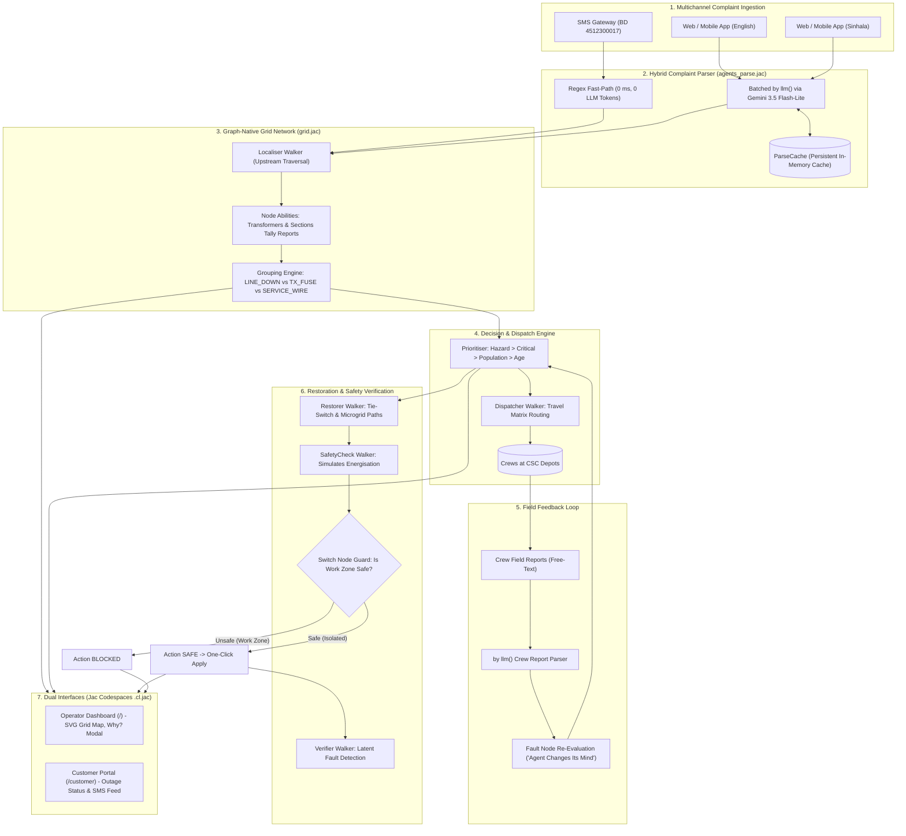

<div align="center">

# GridMedic

**Autonomous AI Decision Support for Power Distribution Networks**  
*Walkers that trace every outage complaint back to its fault.*

[](https://github.com/jaseci-labs/jac)
[](https://www.python.org/)
[](https://pypi.org/project/jaclang/)
[](https://deepmind.google/technologies/gemini/)
[](#running-the-test-suite)
[](#system-architecture)

</div>

---

> *"The grid is a graph, and GridMedic's agents are walkers. They trace complaints upstream; every transformer counts its own reports and every switch guards its own safety. One language from the AI to the map."*

An open-source, graph-native decision support engine built in pure [Jac](https://github.com/jaseci-labs/jac) to modernize electricity distribution operations, automate complaint clustering, and accelerate post-storm power restoration.

---

## 📑 Table of Contents

- [The Real-World Problem](#the-real-world-problem)
- [Key Capabilities](#key-capabilities)
- [System Architecture](#system-architecture)
- [Multi-Agent Workflow](#multi-agent-workflow)
  - [Dynamic Fault Prioritization Algorithm](#dynamic-fault-prioritization-algorithm)
- [Why Pure Jac?](#why-pure-jac)
- [User Interfaces](#user-interfaces)
- [Demo Scenario & Ground Truth](#demo-scenario--ground-truth)
- [API Reference](#api-reference)
- [Quick Start](#quick-start)
- [Running the Test Suite](#running-the-test-suite)
- [Project Layout](#project-layout)
- [Engineering Insights & Optimizations](#engineering-insights--optimizations)
- [Future Work & Production Roadmap](#future-work--production-roadmap)
- [Safety & Operational Principles](#safety--operational-principles)
- [Team & Acknowledgements](#team--acknowledgements)
- [License](#license)

---

## The Real-World Problem

Every storm triggers a deluge of distress calls. During severe weather, utility dispatchers and control-room operators are overwhelmed by thousands of complaints describing the **exact same root fault**:

* One blown 33 kV distribution transformer fuse triggers **80+ urgent phone calls**.
* A fallen medium-voltage line conductor knocks out an entire feeder section, generating **hundreds of complaints**.
* Control rooms struggle to distinguish life-threatening hazards (live wires on roadways, arcing transformers) from minor low-voltage service drops.

This crisis recurs during every monsoon season in South Asia:

* **May 2024 Storms (Sri Lanka):** The Ceylon Electricity Board (CEB) received **over 61,000 breakdown complaints in just six days**, plunging **467,500+ consumers** into darkness ([Daily FT, 27 May 2024](https://ft.lk/news/Inclement-weather-causes-massive-power-outages-countrywide/56-762205)).
* **May 2025 Storms:** CEB reported **29,015 simultaneous breakdowns**, stretching field crews and call centers beyond breaking point ([Ada Derana, 30 May 2025](https://www.adaderana.lk/news/109025/over-29000-electricity-breakdowns-reported-across-sri-lanka)).

Today, complaints flood in across fragmented channels: the `1987` voice hotline, automated SMS (`BD <consumer number>`), the CEBCare mobile app, and web portals. Control rooms lack automated topological reasoning to cluster these reports into actionable root causes, isolate faulted zones, and verify crew safety before re-energising.

---

## Key Capabilities

GridMedic connects directly to incoming complaint streams, translating noisy, multilingual human messages into verified electrical network states and safety-guarded switching actions:

* **Multilingual Ingestion:** Processes standard `BD <consumer_no>` SMS codes with instant regex matching and parses English and Sinhala free text using batched Google Gemini `by llm()` to extract danger cues (*"live wire down"*, *"arcing sparks"*) and local landmarks.
* **Graph-Native Root Cause Tracing:** Spawns Jac `Localiser` walkers that traverse the distribution graph upstream from complaining meters. Substation sections and transformers tally their own reports in real time, clustering hundreds of calls into discrete fault nodes.
* **Multi-Factor Triage & Dispatch:** Dynamically scores faults based on public life safety, critical infrastructure (hospitals, water pumps, school shelters, police), affected headcounts, and waiting duration, routing nearest crews via depot travel matrices.
* **Autonomous Field Feedback & Self-Correction:** Ingests free-text field updates from arriving crews, re-evaluating fault diagnoses on the fly (e.g., converting a suspected transformer failure into an isolated service wire drop).
* **Safety-Guarded Restoration & Verification:** Evaluates alternative backfeeds via normally-open tie switches (TS1) and microgrids. Switches physically refuse closure if the action would energise an active crew work zone. Post-repair walkers monitor incoming reports to expose latent secondary faults.

> [!IMPORTANT]
> **Human-in-the-Loop Safeguard:** GridMedic **never** actuates physical utility switchgear autonomously. It prepares verified, safety-checked switching schedules; human operators review the plain-English evidence ("Why?") and approve every single switching action.

---

## System Architecture

GridMedic is architected as a reactive, graph-centric distribution intelligence engine. The physical grid topology, operational states, AI agents, and reactive user interfaces are written in one coherent Jac codebase.



---

## Multi-Agent Workflow

GridMedic organizes decision-making into specialized Jac walkers and LLM-powered agents:

| Agent / Component | Jac Implementation | Mechanism & Role |
|---|---|---|
| **Complaint Parser** | `agents_parse.jac` | Deterministic regex for `BD <number>` SMS; batched `by llm()` (`Gemini 3.5 Flash-Lite`) with typed semantic contracts (`sem`) for English and Sinhala text. Caches parsed text by hash for instantaneous, zero-cost replays. |
| **Localiser** | `grid.impl/localize.impl.jac` | Graph walker spawned once per complaint batch. Climbs upstream from complaining meters (`Home` → `Transformer` → `Section` → `Substation`); graph nodes execute abilities on walker entry to tally complaint densities. |
| **Fault Grouper** | `agents_group.jac` / `agents_group.impl.jac` | Evaluates downstream reporting ratios. Identifies medium-voltage section line snaps (`LINE_DOWN`), transformer fuse failures (`TX_FUSE`), and street-level low-voltage drops (`SERVICE_WIRE`), attaching plain-English evidence strings. |
| **Prioritiser** | `agents_priority.jac` | Computes dynamic priority scores. Surfaces fallen conductors and sparks first, followed by essential facilities (hospital, water pumping stations, schools, police), affected consumer counts, and outage duration. |
| **Energiser** | `grid.impl/energise.impl.jac` | Bidirectional flood-fill walker. Recomputes power status across sections, switches, transformers, and 600 homes in milliseconds whenever switches change state or repairs complete. |
| **Dispatcher** | `grid.impl/dispatch.impl.jac` | Assigns highest-priority unassigned faults to the closest idle crew using depot travel-time matrices. Animates crew movement along grid coordinates and tags arrival zones as active `work_zone`s. |
| **Field Feedback Agent** | `agents_feedback.jac` / `grid.impl/feedback.impl.jac` | Interprets free-text crew updates with `by llm()`. Directly mutates the underlying `FaultNode` on walker entry, updating fault classification, confidence, and affected customer scopes. |
| **Explainer ("Why?")** | `agents_explain.jac` | Generates clear, two-sentence operational justifications for control-room operators on demand via `by llm()`. Caches output per fault version with an evidence-based algorithmic fallback if offline. |
| **Restorer & SafetyCheck** | `grid.impl/restore.impl.jac` & `grid.impl/safety.impl.jac` | Plans tie-switch re-routing (TS1) and microgrid islanding (hospital diesel, residential solar). `SafetyCheck` steps through each switching sequence; switch nodes actively refuse closure if the step backfeeds an active crew work zone. |
| **Post-Repair Verifier** | `grid.impl/verify.impl.jac` | Monitors consumer complaints arriving within a 5-minute window following a repair. Re-runs localized clustering to uncover secondary faults masked by the initial trip. |

### Dynamic Fault Prioritization Algorithm

During severe storm emergencies, dispatchers cannot treat every outage as equal. GridMedic executes a deterministic multi-factor triage algorithm in [`agents_priority.jac`](file:///c:/Users/SINGER/Documents/GridWalker/agents_priority.jac) that calculates dynamic priority scores across all clustered faults:

$$\text{Priority Score} = 1000 \cdot \mathbb{I}_{\text{hazard}} + 500 \cdot \mathbb{I}_{\text{critical}} + N_{\text{homes}} + 2 \cdot T_{\text{wait}}$$

#### 1. Mathematical Weight Breakdown

| Term | Weight Factor | Value / Condition | Operational Rationale |
|---|---|---|---|
| **Life Safety Hazard** | `HAZARD_WEIGHT = 1000` | $\mathbb{I}_{\text{hazard}} = 1$ if `hazard != NONE` (`WIRE_DOWN`, `SPARKS`, `FIRE`, `TRANSFORMER_NOISE`) | **Zero-harm imperative:** Live conductors downed across public roadways and sparking transformers pose imminent electrocution and fire hazards. Public life-safety always supersedes customer count. |
| **Critical Infrastructure** | `CRITICAL_WEIGHT = 500` | $\mathbb{I}_{\text{critical}} = 1$ if $\text{len}(\text{critical\_loads}) > 0$ | Protects vital community life-support, emergency coordination, and designated public relief shelters (hospitals, water pumps, schools, police). |
| **Affected Population** | $1 \times N_{\text{homes}}$ | $N_{\text{homes}} = \text{homes\_affected}$ | Maximises restoration efficiency across customer bases to minimize system interruption duration (SAIDI). |
| **Starvation Prevention** | `AGE_WEIGHT = 2` | $T_{\text{wait}} = \max(0, \text{clock\_min} - \text{first\_report\_min})$ | Adds 2 points per elapsed minute of waiting since first complaint. Prevents low-voltage street faults from being permanently starved by subsequent incidents. |

#### 2. Critical Infrastructure & School Shelter Rationale

GridMedic recognizes five essential public facilities tagged on the distribution network:

* 🏥 **Lakeview General Hospital** (`T3` / `F1-B`): Intensive care, emergency surgical units, and temperature-controlled medical storage.
* 💧 **Reservoir Road Pumping Station** (`T6` / `F2-A`): Municipal potable water distribution and emergency fire hydrant water pressure.
* 🏫 **Bridge Road Maha Vidyalaya** (`T5` / `F1-C`) & **Railway Avenue Primary School** (`T1` / `F1-A`):
  * **Domain Rationale for Schools:** In Sri Lanka and wider South Asian disaster management protocols, major central school campuses (*Maha Vidyalayas*) are officially designated as primary community evacuation centres, relief hubs, and storm shelters during monsoon flooding and severe weather. Restoring electricity to schools is critical for powering emergency floodlights, operating clean water pumps and sanitation systems, and providing mobile device charging for displaced families.
* 👮 **Ward Place Police Station** (`T10` / `F2-B`): Civil protection, disaster coordination command, and emergency dispatch communications.

#### 3. Deterministic Lifecycle Sorting & Tie-Breaking

Faults are sorted in real time using a 4-tuple composite key:

$$\text{Sort Key} = \Big(\mathbb{I}_{\text{finished}},\; -\text{Priority},\; T_{\text{first\_report}},\; \text{Fault ID}\Big)$$

1. **Terminal State Sinking:** Restored or resolved faults (`RESTORED`, `CLOSED`) have $\mathbb{I}_{\text{finished}} = 1$, instantly sinking them below all active incidents ($\mathbb{I}_{\text{finished}} = 0$) regardless of accumulated points.
2. **Priority Precedence:** Active faults sort by descending priority score ($-\text{Priority}$).
3. **FIFO Tie-Breaking:** In the rare event of identical priority scores, the older fault ($T_{\text{first\_report}}$) is served first, followed by deterministic lexical `Fault ID`.

---

## Why Pure Jac?

GridMedic is written **99.9% in Jac** (with a 15-line CSS file for styling resets). It leverages the full expressive power of the Jaseci ecosystem:

```
──────────────────────────────────────────────────────────────────────────────
Language                  Files        Lines         Code     Comments
──────────────────────────────────────────────────────────────────────────────
Jac (.jac, .cl.jac)          27        4,820        4,150          670   (99.9%)
CSS (.css)                    1           15           15            0   (0.1%)
──────────────────────────────────────────────────────────────────────────────
Total                        28        4,835        4,165          670  (100.0%)
──────────────────────────────────────────────────────────────────────────────
```

### Key Language Features Showcased

1. **Walkers (`walker`) & Graph Topology (`node`, `edge`):** The power grid is fundamentally a directed graph. In Jac, data structures are active participants. Walkers (`Localiser`, `Energiser`, `SafetyCheck`, `Dispatcher`, `Verifier`) physically walk the network, collecting context and modifying node states.
2. **Node Abilities (`can ... with ... entry`):** Behavior is distributed to the nodes where physics happens:
   * `Transformer` nodes increment report tallies when a `Localiser` enters.
   * `Switch` nodes guard their own safety: on `SafetyCheck` entry, a switch inspects visitor context and refuses closure if the circuit feeds into an active crew `work_zone`.
   * `FaultNode`s re-evaluate their own classification when visited by a `CrewReport` walker.
3. **Structured `by llm()` with Semantic Specifications (`sem`):** LLM calls are first-class language constructs. Instead of writing brittle prompt templates and JSON parsers, functions and fields are annotated with `sem` statements. Jac's compiler automatically generates schemas, coordinates with Gemini, and returns strongly-typed Jac objects:
   ```jac
   def parse_crew_report(text: str, fault: Fault) -> CrewFinding by llm();
   sem parse_crew_report = "Interpret a field crew's report about a power fault and say what changed.";
   sem parse_crew_report.text = "The crew's free-text field report.";
   sem parse_crew_report.fault = "The fault the crew was sent to, as currently believed.";
   ```
4. **Native Graph Persistence under `root`:** Zero database configurations, migrations, or ORMs. The entire state persists directly under `root.shared`.
5. **Unified Client/Server Codespaces (`.cl.jac` + `sv import`):** No REST boilerplate or manual `fetch` glue code. UI components in `components/*.cl.jac` import backend walkers directly via `sv import from api { get_grid, tick, start_storm }`, receiving strongly-typed Jac objects with full IDE auto-completion.
6. **Walkers as Public Endpoints (`walker:pub`):** The entire backend API (`api.jac`) consists of thin, typed `walker:pub` declarations exposed over HTTP RPC with zero serialization boilerplate.

---

## User Interfaces

GridMedic serves two specialized, responsive web interfaces from the same single fullstack codebase:

### 1. Control Room Operator Dashboard (`/`)

* **Interactive Single-Line Diagram (SVG):** Live schematic showing 600 individual consumer dots, distribution transformers, feeder lines, switches, reclosers, depots, and active microgrids. Nodes pulse when reporting outages and turn grey when de-energised, red when faulted, and green when restored.
* **Operational Counters & Ranked Fault Cards:** Real-time metrics for total complaints, active faults, and restored homes. Cards display severity badges (⚠️ Hazard, 🏥 Hospital, 💧 Water Pump, 🏫 School, 👮 Police) and confidence. Clicking **"Why?"** opens an AI-generated explanation detailing the diagnostic evidence.
* **Field Crew Tracking & Presets:** Shows crew assignments, travel statuses, and real-time ETAs with quick-report presets to simulate live field updates (*"Preset: T9 Twist"*, *"Preset: Pole 23 Safe"*).
* **Restoration Actions & Safety Guards:** Displays proposed tie-switch and microgrid restoration plans. Unsafe plans are tagged **BLOCKED** with explicit failure rationale; safe plans can be applied with a single click.

### 2. Consumer Outage Portal (`/customer`)

* **10-Digit Consumer Number Search:** Instant lookup (e.g., `4512300017` on T3) displaying live power status, root fault descriptions, assigned crew status, and repair ETAs.
* **Bilingual Outage Reporting:** Supports English and Sinhala text submissions along with landmark cues (*"Near pole 23"*).
* **Simulated SMS Stream:** Real-time log demonstrating automated outbound SMS updates (`1987` / `CEBCare`) dispatched to the consumer as their repair progresses.

---

## Demo Scenario & Ground Truth

The demo simulates a realistic severe weather incident on the fictional **Moratuwa Grid Substation** distribution network:

```
                            [ SUBSTATION SS1 ]
                               /         \
                              /           \
                 FEEDER F1   /             \   FEEDER F2
              (Cap: 700)    /               \  (Cap: 700)
                           /                 \
                     [Section F1-A]     [Section F2-A]
                     (T1-School, T2)     (T6-Pump, T7)
                           |                   |
                     [SW1 Recloser]         [SW3]
                           |                   |
                     [Section F1-B]     [Section F2-B]
                    (T3-Hospital, T4)    (T8, T9, T10-Police)
                           |                   |
                         [SW2]                 |
                            |                   |
                     [Section F1-C]            |
                      (T5-School)              |
                           \                   /
                            \---[ TIE TS1 ]---/
                              (Normally Open)
```

### Network Topology & Facilities

* **Substation:** SS1 Moratuwa Grid Substation.
* **Feeders:** Two 11 kV radial feeders (Feeder 1: 310 homes; Feeder 2: 290 homes; Total: **600 consumers**).
* **Line Sections & Switches:** 5 sections separated by auto-recloser `SW1`, load-break switch `SW2`, sectionaliser `SW3`, and normally-open tie switch `TS1`.
* **10 Transformers:** T1 through T10 feeding named streets (Hospital Road, Lake Road, Bridge Road, etc.).
* **5 Critical Facilities:**
  * 🏥 **Lakeview General Hospital** (T3 / F1-B)
  * 💧 **Reservoir Road Pumping Station** (T6 / F2-A)
  * 👮 **Ward Place Police Station** (T10 / F2-B)
  * 🏫 **Railway Avenue Primary School** (T1 / F1-A; designated flood shelter)
  * 🏫 **Bridge Road Maha Vidyalaya** (T5 / F1-C; primary community storm relief center)
* **2 Microgrids:** `MG-HOSP` (Lakeview Hospital diesel/battery backup) and `MG-RES` (Bridge Road community solar/battery).
* **2 Depots & 3 Crews:** CSC-North (Crew A, Crew B) and CSC-South (Crew C).

### The Storm Scenario: Discovering Ground Truth

When the operator clicks **Start Storm**, ~300 complaints flood in over a simulated 20-minute window. GridMedic autonomously discovers the hidden ground truth:

| Fault | Ground Truth Incident | Physical Impact | AI Agent Behavior & Hero Moments |
|---|---|---|---|
| **F1** | Snapped conductor at **Pole 23 on F1-B** with active arcing sparks; `SW1` trips and locks out. | F1-B & F1-C de-energised; **205 homes off** (including Hospital). | Upstream walkers cluster reports; detects hazard phrases; prioritises F1 at #1; Hospital starts microgrid `MG-HOSP`. |
| **F2** | **Blown transformer fuse at T8**. | 40 homes de-energised. | Localised strictly to T8; standard transformer repair task created. |
| **F3** | **Blown transformer fuse at T6**. | 50 homes off + **Water Pump**. | Critical infrastructure bonus elevates F3 to #2 priority above larger residential faults. |
| **F4** *(Twist)* | Snapped low-voltage **service wire on Lake Road** under T9. | 15 homes on Lake Road off. | Initially suspected as a T9 fuse (conf 0.4). Crew C reports T9 is intact; **GridMedic changes its mind live**, converting F4 to `SERVICE_WIRE` on Lake Road (conf 0.9, 15 homes). |
| **F5** *(Latent)* | **Blown fuse on T4**, hidden behind the upstream F1 line snap. | T4 homes remain unpowered after F1 repair. | `Verifier` detects post-restoration complaints from T4 and spawns a new secondary fault. |

### Safety Check Demonstration: Tie Switch TS1

Section F1-C (Transformer T5, 70 homes) is dark due to the upstream fault on F1-B:
1. **Unsafe Plan (Close TS1 directly):** Closing `TS1` while `SW2` is closed would backfeed high voltage into section F1-B where Crew A is actively working. GridMedic's `SafetyCheck` simulates this step, detects the live `work_zone`, and flags the plan **BLOCKED**.
2. **Safe Plan (Open SW2, then Close TS1):** Isolates F1-B by opening `SW2` first, then closes `TS1` to backfeed F1-C from Feeder 2. The safety check verifies Feeder 2 capacity (290 + 70 = 360 ≤ 700 homes capacity), marks the action **SAFE**, and one click restores all 70 homes on T5.

---

## API Reference

GridMedic exposes 14 reactive `walker:pub` endpoints served over HTTP POST (`http://localhost:8001/walker/<endpoint_name>`), imported directly by client UI components via Jac's `sv import` bridge:

| Endpoint | Parameters | Returns | Description |
|---|---|---|---|
| `get_grid` | None | `GridView` | Returns all active nodes, edges, states, and counters for single-line diagram rendering. |
| `start_storm` | `speed: int` | `Ack` | Initializes the storm scenario clock and loads the complaint queue (1x, 5x, 20x). |
| `tick` | `minutes: float` | `Ack` | Advances the simulated clock, releases due complaints, runs localizing, and advances crew movement. |
| `submit_complaint` | `text: str`, `consumer_no: str` | `Complaint` | Ingests an individual consumer outage report, parses hazards, and maps to the grid graph. |
| `get_complaints` | `since_min: float` | `list[Complaint]` | Streams incoming complaints in chronological arrival order. |
| `get_faults` | None | `list[Fault]` | Returns the current list of clustered faults, sorted by multi-factor priority score. |
| `get_crews` | None | `list[Crew]` | Returns all repair crews with their current depot, location, status, and assigned tasks. |
| `get_tasks` | None | `list[CrewTask]` | Lists active dispatches, destination coordinates, and estimated arrival times (ETAs). |
| `crew_report` | `crew_id: str`, `text: str` | `Fault` | Ingests unstructured field notes from a crew, triggering LLM re-evaluation of the fault node. |
| `explain` | `fault_id: str` | `Fault` | Generates a 2-sentence plain-English justification ("Why?") explaining root-cause diagnosis. |
| `get_actions` | None | `list[Action]` | Generates proposed tie-switch and microgrid restoration plans with automated safety proofs. |
| `apply_action` | `action_id: str` | `ActionResult` | Executes an approved restoration sequence, validates safety constraints, and updates power flow. |
| `get_events` | `since_min: float` | `list[Event]` | Returns a chronological log of system actions, mind-change events, arrivals, and switching operations. |
| `get_status` | `consumer_no: str` | `CustomerStatus` | Customer portal status lookup returning live power status, root cause description, and repair ETA. |
| `reset` | None | `Ack` | Restores normal grid topology, clears operational faults, and resets simulation state. |

---

## Quick Start

### Prerequisites

* **Operating System:** Windows, Linux, or macOS.
* **Python:** Version >= 3.12.
* **Google Gemini API Key:** From [Google AI Studio](https://aistudio.google.com/).

### 1. Installation

```bash
pip install jaclang==0.16.7 jac-client==0.3.25 byllm==0.6.19
jac install
```

### 2. Environment Setup

Configure your Gemini API key and disable LLVM optimization to avoid native library conflicts with `llvmlite`:

**PowerShell (Windows):**
```powershell
$env:GEMINI_API_KEY = "your-gemini-api-key"
$env:JAC_OPT_LEVEL = "0"
```

**Bash (Linux / macOS):**
```bash
export GEMINI_API_KEY="your-gemini-api-key"
export JAC_OPT_LEVEL="0"
```

### 3. Launch Development Server

```bash
jac start --dev
```

* **Operator Dashboard:** [http://localhost:8000](http://localhost:8000)
* **Customer Outage Page:** [http://localhost:8000/customer](http://localhost:8000/customer)
* **Backend API RPC Port:** `http://localhost:8001`

> [!TIP]
> **Live Smoke Test:** Verify your Gemini API key and Sinhala semantic parsing directly by running:
> ```bash
> jac run scripts/smoke_llm.jac
> ```

---

## Running the Test Suite

GridMedic includes a comprehensive suite of automated unit and acceptance tests covering end-to-end functionality across all subsystems.

> [!IMPORTANT]
> Because Jac persists graph state under `root.shared`, always stop any running dev server and clean cache before running test suites:

```bash
jac clean --all --force
jac test tests/acceptance_tests.jac
```

### Test Suite Matrix

| Test Suite | Purpose & Coverage |
|---|---|
| `tests/acceptance_tests.jac` | Full storm end-to-end processing, F1–F4 grouping, hazard detection, and Crew C mind-change twist. |
| `tests/noise_tests.jac` | Duplicate SMS filtering and false-report rejection from healthy transformers (T7). |
| `tests/dispatch_tests.jac` | Nearest-crew travel calculation, live status transitions, and arrival work-zone tagging. |
| `tests/energise_tests.jac` | Bidirectional flood-fill power propagation across normal and tie-backfed states. |
| `tests/microgrid_tests.jac` | Anti-backfeed isolator locks on hospital and solar microgrids. |
| `tests/safety_tests.jac` | Backfeed prevention proving plans energising active crew work zones are strictly blocked. |
| `tests/verifier_tests.jac` | Detection and localized clustering of latent secondary transformer faults post-repair. |

---

## Project Layout

```
gridmedic/
├── main.jac                    # Entry point & client app mounting
├── jac.toml                    # Jac runtime configuration & byLLM model definitions
├── gm_types.jac                # Core data contracts: Complaint, Fault, Crew, Enums
├── grid.jac                    # Grid graph declaration: nodes, edges, and walkers
│
├── grid.impl/                  # Walker and node-ability implementation annexes
│   ├── localize.impl.jac       #   Localiser walker & node tally abilities
│   ├── energise.impl.jac       #   Energiser bidirectional power flow walker
│   ├── dispatch.impl.jac       #   Dispatcher walker & crew travel simulation
│   ├── feedback.impl.jac       #   CrewReport walker & FaultNode re-evaluation
│   ├── restore.impl.jac        #   Restorer walker & tie/microgrid plan generation
│   ├── safety.impl.jac         #   SafetyCheck walker & Switch node guard abilities
│   └── verify.impl.jac         #   Verifier walker for latent post-repair faults
│
├── grid_build.jac              # Generates the 600-consumer demo network topology
├── grid_storm.jac              # Scenario generator: ground truth & ~300 complaints
├── sim.jac                     # Simulation engine: clock management, events, locks
├── api.jac                     # Public API: 14 reactive walker:pub endpoints
│
├── agents_parse.jac            # Regex SMS parser & batched by llm() Gemini NLP
├── agents_group.jac            # Clustering engine: groups node tallies into faults
├── agents_priority.jac         # Multi-factor priority scoring formula
├── agents_feedback.jac         # Unstructured field report parsing via by llm()
├── agents_explain.jac          # Plain-English "Why?" justifications via by llm()
│
├── ui_app.cl.jac               # Operator dashboard shell, event loop, and state
├── ui_customer.cl.jac          # Consumer portal: bilingual reporting & SMS stream
├── components/                 # Client UI components (GridMap, ActionsPanel, CrewPanel)
└── tests/                      # Automated unit and acceptance test suites
```

---

## Engineering Insights & Optimizations

* **80x Traversal Speedup:** High-level edge filters like `[n <-:Feeds:<-]` across inherited classes cost ~12 ms per node evaluation on 600-node graphs. Implementing lightweight traversal helpers (`children` / `parents`) in `grid.jac` dropped graph sweep latency from **9.2 s to 0.13 s**.
* **Batch-Spawn Walker Architecture:** Spawning a walker carries ~0.2 s overhead. Spawning separate walkers for 300 complaints would stall the simulation loop. The `Localiser` is spawned once per tick with all new complaints in `starts: list[GridNode]`, localizing **109 complaints in 0.4 seconds**.
* **Local Twin LLM Pattern:** To avoid `byllm` 0.6.19 cross-module typing issues with imported schemas, LLM output objects (`LlmParsed`, `CrewFinding`) are declared locally in the exact module hosting the `by llm()` function with `sem` annotations, then mapped into shared `gm_types.jac` contracts.
* **Quota Efficiency & Zero-Cost Replays:** Automated `BD <consumer_no>` SMS codes bypass the LLM entirely (0 ms, 0 tokens). Free-text complaints are processed in batches of 10 and indexed by hash in `ParseCache`, enabling full demo replays with **zero external API calls**.

---

## 🚀 Future Work & Production Roadmap

To scale GridMedic from an interactive decision-support system to enterprise utility deployment (e.g., across the Ceylon Electricity Board):

1. **GIS & IEC CIM Automated Ingestion:** Direct converters to import utility Geographic Information System (GIS) datasets (Esri Shapefile, GeoJSON) and IEC 61970/61968 CIM/XML network models straight into persistent Jac graphs with zero manual topology coding.
2. **Live Telecommunications & Omnichannel Voice:** Production SMS webhook gateways (Dialog, Mobitel, SLT, Twilio) for two-way SMS, CEBCare mobile app API connectors, and multilingual streaming voice AI (Whisper / Gemini Live) for automated `1987` phone triage in Sinhala, Tamil, and English.
3. **SCADA & Smart Meter (AMI) Correlation:** Real-time correlation with SCADA relay trip signals and smart meter power-loss "last-gasp" pings to confirm fault boundaries before the first consumer report arrives.
4. **Field Lineman Mobile App & GPS Telematics:** A lightweight Jac-powered mobile client for field crews providing turn-by-turn routing, live GPS tracking, and photo-based visual damage verification via Gemini Vision.
5. **AC Power Flow & Thermal Constraints:** Integrating AC Optimal Power Flow (OPF) and voltage constraint solvers to guarantee that tie-switch load transfers never overload alternative feeders.

---

## Safety & Operational Principles

* **Human-in-the-Loop Control:** GridMedic is an advisory platform engineered to empower utility control engineers. It does **not** autonomously actuate physical circuit breakers, reclosers, or switchgear without explicit operator authorization.
* **Deterministic Safety Verification:** Every switching operation generated by LLMs or heuristic algorithms is strictly pre-validated by deterministic topological graph walkers (`SafetyCheck`) before presentation to operators.
* **Synthetic Demonstration Grid:** To protect critical national infrastructure security and consumer privacy, the reference grid topology and customer meter accounts in this repository are synthetic models based on realistic radial distribution designs.

---

## Team & Acknowledgements

### Project Contributors
* **Malitha Bandara** ([@MalithaBandara](https://github.com/MalithaBandara))
* **Yasith Gurunayake** ([@yasithgurunayake](https://github.com/yasithgurunayake))
* **Isindu Heshan** ([@isinduheshan](https://github.com/isinduheshan))

### Acknowledgements
Originally created for the **AI Hackathon 2026, powered by Jaseci Labs** at the Department of Electrical Engineering, University of Moratuwa.

---

## License

This project is licensed under the [Apache License 2.0](https://www.apache.org/licenses/LICENSE-2.0).
