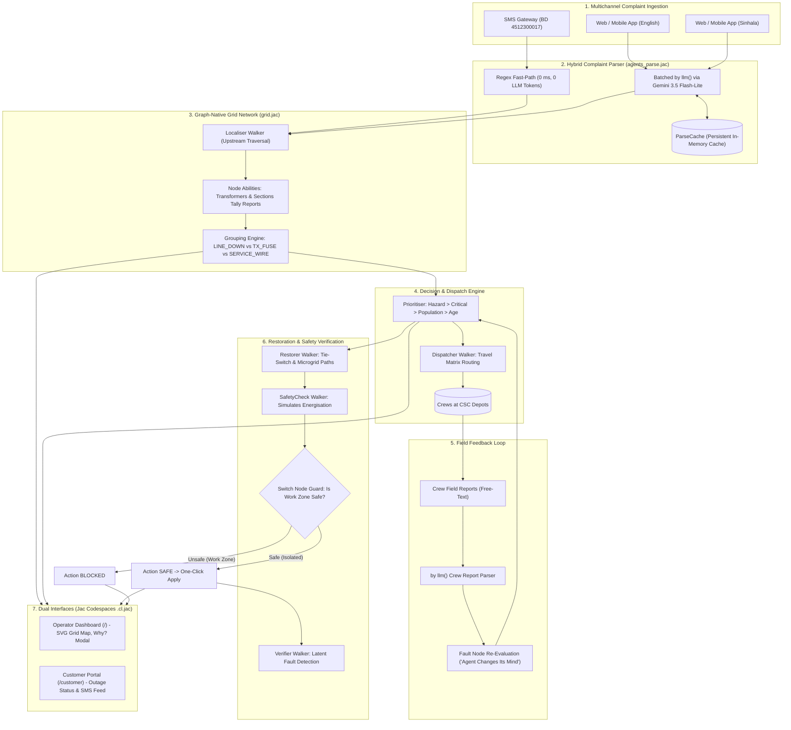

# ⚡ GridMedic

<div align="center">

**Autonomous AI Decision Support for Power Distribution Networks**  
*Walkers that trace every outage complaint back to its fault.*

[](https://github.com/jaseci-labs/jac)
[](https://www.python.org/)
[](https://pypi.org/project/jaclang/)
[](https://deepmind.google/technologies/gemini/)
[](https://www.jaseci.org/)
[](#status)

</div>

---

> *"The grid is a graph, and GridMedic's agents are walkers. They trace complaints upstream; every transformer counts its own reports and every switch guards its own safety. One language from the AI to the map."*

Built from the ground up in pure [Jac](https://github.com/jaseci-labs/jac) for the **AI Hackathon 2026, powered by Jaseci Labs** (University of Moratuwa, 17 Oct 2026).

---

## 📑 Table of Contents

- [The Real-World Problem](#the-real-world-problem)
- [What GridMedic Does](#what-gridmedic-does)
- [System Architecture](#system-architecture)
- [Multi-Agent Workflow](#multi-agent-workflow)
- [Why Pure Jac?](#why-pure-jac)
- [User Interfaces](#user-interfaces)
- [Demo Scenario & Ground Truth](#demo-scenario--ground-truth)
- [Quick Start](#quick-start)
- [Running the Test Suite](#running-the-test-suite)
- [Project Layout](#project-layout)
- [Engineering Insights & Jac Traversal Benchmarks](#engineering-insights--jac-traversal-benchmarks)
- [Limitations & Ethical Disclosures](#limitations--ethical-disclosures)
- [The Team](#the-team)

---

## The Real-World Problem

Every power outage triggers a deluge of distress calls and messages. During severe weather, emergency dispatchers and control-room operators are overwhelmed by thousands of complaints describing the **exact same root fault**:

* One blown $33\text{ kV}$ distribution transformer fuse can generate **80+ urgent phone calls**.
* A fallen medium-voltage line conductor can knock out an entire feeder section and bring **hundreds of complaints**.
* Control rooms struggle to distinguish high-risk life-safety hazards (live wires on roads, sparking transformers) from minor low-voltage service wire faults.

This crisis occurs during every monsoon season in South Asia:

* **May 2024 Storms (Sri Lanka):** The Ceylon Electricity Board (CEB) received **over 61,000 breakdown complaints in just six days**, plunging **467,500+ consumers** into darkness ([Daily FT, 27 May 2024](https://ft.lk/news/Inclement-weather-causes-massive-power-outages-countrywide/56-762205)).
* **May 2025 Storms:** CEB reported **29,015 simultaneous breakdowns**, stretching field crews and call centers beyond breaking point ([Ada Derana, 30 May 2025](https://www.adaderana.lk/news/109025/over-29000-electricity-breakdowns-reported-across-sri-lanka)).

Today, complaints flood in across disparate channels: the `1987` voice hotline, automated SMS (`BD <consumer number>`), the CEBCare mobile app, and public web portals ([CEB Supply Services Code](https://www.ceb.lk/front_img/img_reports/1532507262Supply_Services_Code_DD2.pdf)). Control rooms lack automated topological reasoning to cluster these complaints into actionable root causes, isolate faulted zones, and verify crew safety before re-energising.

---

## What GridMedic Does

GridMedic is an **autonomous, graph-native AI decision-support platform** that connects directly to a utility's inbound complaint streams. It translates noisy, multilingual human messages into verified electrical network states and safety-guarded switching actions:

1. **Understands Messy Multilingual Reports:** Ingests standard `BD <consumer_no>` SMS codes alongside noisy English and Sinhala free text. Uses deterministic regex for instant SMS matching and batched Google Gemini `by llm()` parsing for natural language. It extracts danger signals (fallen wires, arcing sparks, transformer fires) and local landmarks (*"near pole 23"*, *"hospital road"*).
2. **Traces Root Causes via Topological Walkers:** Instead of querying relational databases, Jac `Localiser` walkers traverse the distribution graph upstream from affected consumer meters. Substation sections and transformers tally their own reports in real time, clustering hundreds of calls into discrete faults: a snapped MV line conductor, a blown transformer fuse, or an isolated LV service drop.
3. **Prioritises by Life Safety & Critical Infrastructure:** Dynamically ranks faults using a multi-factor formula:
   $$\text{Score} = 1000 \cdot [\text{Hazard}] + 500 \cdot [\text{Critical Load}] + [\text{Homes Affected}] + 2 \cdot [\text{Wait Minutes}]$$
   Active hazards (live conductors on roads) and life-support infrastructure (hospitals, water pumping stations, schools, police depots) jump straight to the top of the queue.
4. **Dispatches Field Crews Intelligently:** Computes travel times from Consumer Service Centre (CSC) depots to grid zones and dispatches the nearest available crew. Tracks crew travel and arrival in real time.
5. **Self-Corrects from Field Feedback ("Agent Changes Its Mind"):** When a crew arrives on site and sends unstructured field notes (*"T9 transformer is fine, fuse intact; overhead service line snapped on Lake Road"*), GridMedic's feedback agent parses the report with Gemini, re-evaluates the fault node on the fly, adjusts the affected count from 75 to 15 homes, and highlights the correction to the operator.
6. **Safety-Guarded Restoration & Microgrid Islanding:** Discovers alternative backfeed routes via normally-open tie switches (TS1) and local microgrids (hospital diesel/battery backup, community solar). Before any switch closes, a `SafetyCheck` walker simulates power propagation: **switches actively refuse to close if the action would energise or backfeed a section marked as an active crew work zone**.
7. **Verifies Fixes & Exposes Latent Faults:** Once a primary fault is restored, a `Verifier` walker monitors incoming complaint patterns. If complaints continue from downstream consumers within a 5-minute window, it isolates secondary faults previously masked by the upstream outage.

> [!IMPORTANT]
> **Human-in-the-Loop Safeguard:** GridMedic **never** actuates physical utility switchgear autonomously. It prepares verified, safety-checked switching schedules; human operators review the plain-English evidence ("Why?") and approve every single switching action.

---

## System Architecture

GridMedic is architected as a reactive, graph-centric distribution intelligence engine. The physical grid topology, operational states, AI agents, and reactive user interfaces are written in one coherent Jac codebase.



---

## Multi-Agent Workflow

GridMedic organizes decision-making into specialized Jac walkers and LLM-powered agents:

| Agent / Component | Jac Implementation | Mechanism & Role |
|---|---|---|
| **Complaint Parser** | `agents_parse.jac` | Deterministic regex for `BD <number>` SMS; batched `by llm()` (`Gemini 3.5 Flash-Lite`) with typed semantic contracts (`sem`) for English and Sinhala text. Caches parsed text by hash for instantaneous, zero-cost replays. |
| **Localiser** | `grid.impl/localize.impl.jac` | Graph walker spawned once per complaint batch. Climbs upstream from complaining meters (`Home` $\to$ `Transformer` $\to$ `Section` $\to$ `Substation`); graph nodes execute abilities on walker entry to tally complaint densities. |
| **Fault Grouper** | `agents_group.jac` / `agents_group.impl.jac` | Evaluates downstream reporting ratios. Identifies medium-voltage section line snaps (`LINE_DOWN`), transformer fuse failures (`TX_FUSE`), and street-level low-voltage drops (`SERVICE_WIRE`), attaching plain-English evidence strings. |
| **Prioritiser** | `agents_priority.jac` | Computes dynamic priority scores. Surfaces fallen conductors and sparks first, followed by essential facilities (hospital, water pumping stations, schools, police), affected consumer counts, and outage duration. |
| **Energiser** | `grid.impl/energise.impl.jac` | Bidirectional flood-fill walker. Recomputes power status across sections, switches, transformers, and 600 homes in milliseconds whenever switches change state or repairs complete. |
| **Dispatcher** | `grid.impl/dispatch.impl.jac` | Assigns highest-priority unassigned faults to the closest idle crew using depot travel-time matrices. Animates crew movement along grid coordinates and tags arrival zones as active `work_zone`s. |
| **Field Feedback Agent** | `agents_feedback.jac` / `grid.impl/feedback.impl.jac` | Interprets free-text crew updates with `by llm()`. Directly mutates the underlying `FaultNode` on walker entry, updating fault classification, confidence, and affected customer scopes. |
| **Explainer ("Why?")** | `agents_explain.jac` | Generates clear, two-sentence operational justifications for control-room operators on demand via `by llm()`. Caches output per fault version with an evidence-based algorithmic fallback if offline. |
| **Restorer & SafetyCheck** | `grid.impl/restore.impl.jac` & `grid.impl/safety.impl.jac` | Plans tie-switch re-routing (TS1) and microgrid islanding (hospital diesel, residential solar). `SafetyCheck` steps through each switching sequence; switch nodes actively refuse closure if the step backfeeds an active crew work zone. |
| **Post-Repair Verifier** | `grid.impl/verify.impl.jac` | Monitors consumer complaints arriving within a 5-minute window following a repair. Re-runs localized clustering to uncover secondary faults masked by the initial trip. |

---

## Why Pure Jac?

GridMedic is written **99.9% in Jac** (with a 15-line CSS file for styling resets). It leverages the full expressive power of the Jaseci ecosystem:

```
──────────────────────────────────────────────────────────────────────────────
Language                  Files        Lines         Code     Comments
──────────────────────────────────────────────────────────────────────────────
Jac (.jac, .cl.jac)          27        4,820        4,150          670   (99.9%)
CSS (.css)                    1           15           15            0   (0.1%)
──────────────────────────────────────────────────────────────────────────────
Total                        28        4,835        4,165          670  (100.0%)
──────────────────────────────────────────────────────────────────────────────
```

### Key Language Features Showcased

1. **Walkers (`walker`) & Graph Topology (`node`, `edge`):** The power grid is fundamentally a directed graph. In Jac, data structures are active participants. Walkers (`Localiser`, `Energiser`, `SafetyCheck`, `Dispatcher`, `Verifier`) physically walk the network, collecting context and modifying node states.
2. **Node Abilities (`can ... with ... entry`):** Behavior is distributed to the nodes where physics happens:
   * `Transformer` nodes increment report tallies when a `Localiser` enters.
   * `Switch` nodes guard their own safety: on `SafetyCheck` entry, a switch inspects visitor context and refuses closure if the circuit feeds into an active crew `work_zone`.
   * `FaultNode`s re-evaluate their own classification when visited by a `CrewReport` walker.
3. **Structured `by llm()` with Semantic Specifications (`sem`):** LLM calls are first-class language constructs. Instead of writing brittle prompt templates and JSON parsers, functions and fields are annotated with `sem` statements. Jac's compiler automatically generates schemas, coordinates with Gemini, and returns strongly-typed Jac objects:
   ```jac
   def parse_crew_report(text: str, fault: Fault) -> CrewFinding by llm();
   sem parse_crew_report = "Interpret a field crew's report about a power fault and say what changed.";
   sem parse_crew_report.text = "The crew's free-text field report.";
   sem parse_crew_report.fault = "The fault the crew was sent to, as currently believed.";
   ```
4. **Native Graph Persistence under `root`:** Zero database configurations, migrations, or ORMs. The entire state—substation, feeders, switches, transformers, homes, complaints, faults, and crew objects—persists directly under `root.shared`.
5. **Unified Client/Server Codespaces (`.cl.jac` + `sv import`):** No REST boilerplate or manual `fetch` glue code. UI components in `components/*.cl.jac` import backend walkers directly via `sv import from api { get_grid, tick, start_storm }`, receiving strongly-typed Jac objects with full IDE auto-completion.
6. **Walkers as Public Endpoints (`walker:pub`):** The entire backend API (`api.jac`) consists of thin, typed `walker:pub` declarations exposed over HTTP RPC with zero serialization boilerplate.

---

## User Interfaces

GridMedic serves two specialized, responsive web interfaces from the same single fullstack codebase:

### 1. Control Room Operator Dashboard (`/`)

Built for utility control engineers managing major outage events:

* **Interactive Single-Line Diagram (SVG):** Live schematic showing 600 individual consumer dots, distribution transformers, feeder lines, switches, reclosers, depots, and active microgrids. Nodes pulse when reporting outages and turn grey when de-energised, red when faulted, and green when restored.
* **Live Operational Counters:** Real-time metrics for total complaints received, active faults detected, consumers without power, critical facilities affected, and homes restored.
* **Ranked Fault Cards with "Why?" Explanations:** Ranked list showing severity badges (⚠️ Hazard, 🏥 Hospital, 💧 Water Pump, 🏫 School, 👮 Police), affected headcounts, and confidence. Clicking **"Why?"** opens an AI-generated explanation detailing the exact evidence behind the diagnosis.
* **Field Crew Tracking & Presets:** Shows crew assignments, travel statuses, and real-time ETAs. Includes quick-report presets to simulate live field updates (*"Preset: T9 Twist"*, *"Preset: Pole 23 Safe"*).
* **Restoration Actions Panel:** Displays calculated tie-switch and microgrid restoration plans with safety validations. Unsafe plans are clearly tagged **BLOCKED** with explicit failure rationale; safe plans can be applied with a single click.
* **Floating Simulation Controls:** Allows the operator to start the storm, adjust simulation speed ($1\times$, $5\times$, $20\times$), pause, and reset the environment.

### 2. Consumer Outage Portal (`/customer`)

A public-facing self-service portal for electricity consumers:

* **10-Digit Consumer Number Search:** Instant lookup (e.g., `4512300017` on T3) displaying live power status, root fault descriptions, assigned crew status, and repair ETAs.
* **Bilingual Outage Reporting:** Supports English and Sinhala text submissions along with landmark cues (*"Near pole 23"*).
* **Simulated SMS Stream:** Real-time log demonstrating the automated outbound SMS messages (`1987` / `CEBCare`) dispatched to the consumer as their repair progresses.

---

## Demo Scenario & Ground Truth

The demo simulates a realistic severe weather incident on the fictional **Moratuwa Grid Substation** distribution network:

```
                            [ SUBSTATION SS1 ]
                               /         \
                              /           \
                 FEEDER F1   /             \   FEEDER F2
              (Cap: 700)    /               \  (Cap: 700)
                           /                 \
                     [Section F1-A]     [Section F2-A]
                     (T1-School, T2)     (T6-Pump, T7)
                           |                   |
                     [SW1 Recloser]         [SW3]
                           |                   |
                     [Section F1-B]     [Section F2-B]
                    (T3-Hospital, T4)    (T8, T9, T10-Police)
                           |                   |
                         [SW2]                 |
                           |                   |
                     [Section F1-C]            |
                      (T5-School)              |
                           \                   /
                            \---[ TIE TS1 ]---/
                              (Normally Open)
```

### Network Topology & Facilities

* **Substation:** SS1 Moratuwa Grid Substation.
* **Feeders:** Two $11\text{ kV}$ radial feeders (Feeder 1: 310 homes; Feeder 2: 290 homes; Total: **600 consumers**).
* **Line Sections & Switches:** 5 sections separated by auto-recloser `SW1`, load-break switch `SW2`, sectionaliser `SW3`, and normally-open tie switch `TS1`.
* **10 Transformers:** T1 through T10 feeding named streets (Hospital Road, Lake Road, Bridge Road, etc.).
* **5 Critical Facilities:**
  * 🏥 **Lakeview General Hospital** (T3 / F1-B)
  * 💧 **Reservoir Road Pumping Station** (T6 / F2-A)
  * 👮 **Ward Place Police Station** (T10 / F2-B)
  * 🏫 **Railway Avenue Primary School** (T1 / F1-A)
  * 🏫 **Bridge Road Maha Vidyalaya** (T5 / F1-C)
* **2 Microgrids:**
  * **MG-HOSP:** Dedicated diesel/battery backup for Lakeview Hospital (240 min capacity).
  * **MG-RES:** Community solar/battery bank on T5 capable of islanding 80 homes (120 min capacity).
* **2 Depots & 3 Crews:** CSC-North (Crew A, Crew B) and CSC-South (Crew C).

### The Storm Scenario: Discovering Ground Truth

When the operator clicks **Start Storm**, ~300 complaints flood in over a simulated 20-minute window. GridMedic must autonomously discover the hidden ground truth:

| Fault | Ground Truth Incident | Physical Impact | AI Agent Behavior & Hero Moments |
|---|---|---|---|
| **F1** | Snapped conductor at **Pole 23 on F1-B** with active arcing sparks; `SW1` trips and locks out. | F1-B & F1-C de-energised; **205 homes off** (including Hospital). | Upstream walkers cluster reports; detects hazard phrases; prioritises F1 at #1; Hospital starts microgrid `MG-HOSP`. |
| **F2** | **Blown transformer fuse at T8**. | 40 homes de-energised. | Localised strictly to T8; standard transformer repair task created. |
| **F3** | **Blown transformer fuse at T6**. | 50 homes off + **Water Pump**. | Critical infrastructure bonus elevates F3 to #2 priority above larger residential faults. |
| **F4** *(Twist)* | Snapped low-voltage **service wire on Lake Road** under T9. | 15 homes on Lake Road off. | Initially suspected as a T9 fuse (conf 0.4). Crew C reports T9 is intact; **GridMedic changes its mind live**, converting F4 to `SERVICE_WIRE` on Lake Road (conf 0.9, 15 homes). |
| **F5** *(Latent)* | **Blown fuse on T4**, hidden behind the upstream F1 line snap. | T4 homes remain unpowered after F1 repair. | `Verifier` detects post-restoration complaints from T4 and spawns a new secondary fault. |

### Safety Check Demonstration: Tie Switch TS1

Section F1-C (Transformer T5, 70 homes) is dark due to the upstream fault on F1-B:
1. **Unsafe Plan (Close TS1 directly):** Closing `TS1` while `SW2` is closed would backfeed high voltage into section F1-B where Crew A is actively working. GridMedic's `SafetyCheck` simulates this step, detects the live `work_zone`, and flags the plan **BLOCKED**.
2. **Safe Plan (Open SW2, then Close TS1):** Isolates F1-B by opening `SW2` first, then closes `TS1` to backfeed F1-C from Feeder 2. The safety check verifies Feeder 2 capacity ($290 + 70 = 360 \le 700$), marks the action **SAFE**, and one click restores all 70 homes on T5.

---

## Quick Start

### Prerequisites

* **Operating System:** Windows, Linux, or macOS.
* **Python:** Version $\ge 3.12$.
* **Google Gemini API Key:** Get a key from [Google AI Studio](https://aistudio.google.com/).

### 1. Installation

Install the Jac compiler and toolchain packages:

```bash
pip install jaclang==0.16.7 jac-client==0.3.25 byllm==0.6.19
jac install
```

### 2. Environment Setup

Configure your Gemini API key and disable LLVM optimization to avoid native library conflicts with `llvmlite`:

**PowerShell (Windows):**
```powershell
$env:GEMINI_API_KEY = "your-gemini-api-key"
$env:JAC_OPT_LEVEL = "0"
```

**Bash (Linux / macOS):**
```bash
export GEMINI_API_KEY="your-gemini-api-key"
export JAC_OPT_LEVEL="0"
```

### 3. Launch Development Server

Start the fullstack application in dev mode:

```bash
jac start --dev
```

* **Operator Dashboard:** Open [http://localhost:8000](http://localhost:8000)
* **Customer Outage Page:** Open [http://localhost:8000/customer](http://localhost:8000/customer)
* **API Endpoint Port:** Running on `http://localhost:8001`

> [!TIP]
> **Live Smoke Test:** Verify your Gemini API key and Sinhala semantic parsing directly by running:
> ```bash
> jac run scripts/smoke_llm.jac
> ```

---

## Running the Test Suite

GridMedic includes a comprehensive suite of automated unit and acceptance tests covering every operational tier.

> [!IMPORTANT]
> Because Jac persists graph state under `root.shared`, always stop any running dev server before testing, and run `jac clean --all --force` between test files:

Run the entire test pipeline with the built-in script:

```bash
jac clean --all --force
jac test tests/acceptance_tests.jac
jac clean --all --force
jac test tests/noise_tests.jac
jac clean --all --force
jac test tests/dispatch_tests.jac
jac clean --all --force
jac test tests/energise_tests.jac
jac clean --all --force
jac test tests/microgrid_tests.jac
jac clean --all --force
jac test tests/safety_tests.jac
jac clean --all --force
jac test tests/verifier_tests.jac
```

### Acceptance Test Coverage

* `tests/acceptance_tests.jac`: Validates end-to-end storm processing, F1–F4 grouping, hazard detection, and the Crew C mind-change twist.
* `tests/noise_tests.jac`: Asserts that duplicate SMS reports are ignored and false reports from healthy transformers (T7) do not spawn phantom faults.
* `tests/dispatch_tests.jac`: Verifies nearest-crew travel calculation, live status transitions, and arrival work-zone tagging.
* `tests/energise_tests.jac`: Tests the bidirectional flood-fill algorithm across normal and tie-backfed states.
* `tests/microgrid_tests.jac`: Verifies anti-backfeed isolator locks on hospital and solar microgrids.
* `tests/safety_tests.jac`: Proves that switching plans backfeeding into active crew work zones are strictly blocked.
* `tests/verifier_tests.jac`: Validates detection of latent secondary transformer faults following primary repairs.

---

## Project Layout

```
gridmedic/
├── main.jac                    # Application entry point & client mounting
├── jac.toml                    # Jac project configuration & byLLM model definitions
├── global.css                  # Minimal CSS resets (<15 lines)
│
├── gm_types.jac                # Shared contracts: enums, complaint, fault, crew data structures
├── gm_types.impl.jac           # Type labelling and enum string conversion helpers
├── grid.jac                    # Complete graph declaration: nodes, edges, and walkers
│
├── grid.impl/                  # Walker and node-ability implementation annexes
│   ├── localize.impl.jac       #   Localiser walker & node tally abilities
│   ├── energise.impl.jac       #   Energiser bidirectional power flow walker
│   ├── dispatch.impl.jac       #   Dispatcher walker & crew travel simulation
│   ├── feedback.impl.jac       #   CrewReport walker & FaultNode re-evaluation
│   ├── restore.impl.jac        #   Restorer walker & tie/microgrid plan generation
│   ├── safety.impl.jac         #   SafetyCheck walker & Switch node guard abilities
│   ├── verify.impl.jac         #   Verifier walker for latent post-repair faults
│   └── view.impl.jac           #   Snapshot walker for serialising UI views
│
├── grid_build.jac              # Generates the 600-consumer demo network topology
├── grid_storm.jac              # Scenario generator: ground truth & ~300 complaints
├── sim.jac                     # Simulation engine: clock management, events, locks
├── sim.impl.jac                # Simulation loop, REST handlers, and cache pipelines
├── api.jac                     # Public API: 14 walker:pub endpoints
│
├── agents_parse.jac            # Regex SMS parser & batched by llm() Gemini NLP
├── agents_group.jac            # Clustering engine: groups node tallies into faults
├── agents_priority.jac         # Multi-factor priority scoring formula
├── agents_feedback.jac         # Unstructured field report parsing via by llm()
├── agents_explain.jac          # Plain-English "Why?" justifications via by llm()
│
├── ui_app.cl.jac               # Operator dashboard shell, event loop, and state
├── ui_app.impl.jac             # Operator dashboard event handlers and RPC bindings
├── ui_customer.cl.jac          # Consumer portal: bilingual reporting & SMS stream
├── ui_customer.impl.jac        # Consumer portal status lookup & submission handlers
│
├── components/                 # Client UI components
│   ├── GridMap.cl.jac          #   Interactive SVG single-line distribution diagram
│   ├── ActionsPanel.cl.jac     #   Switching schedule preview & safety execution
│   └── CrewPanel.cl.jac        #   Crew dispatch cards, ETAs, and report modal
│
├── scripts/
│   ├── smoke_llm.jac           # Real-LLM validation script for Gemini & Sinhala parsing
│   └── storm_stats.jac         # Scenario complaint distribution diagnostics
│
└── tests/                      # Automated acceptance test suites
    ├── acceptance_tests.jac    #   Full storm end-to-end verification
    ├── noise_tests.jac         #   Duplicate & false-report filtering
    ├── dispatch_tests.jac      #   Travel times & work-zone tagging
    ├── energise_tests.jac      #   Power propagation & isolation tests
    ├── microgrid_tests.jac     #   Hospital & residential microgrid islanding
    ├── safety_tests.jac        #   Backfeed prevention & safety guarding
    └── verifier_tests.jac      #   Latent fault detection tests
```

---

## Engineering Insights & Jac Traversal Benchmarks

During the design and testing of GridMedic on a 600-home network, several performance characteristics of the Jac runtime were identified and solved:

### 1. Graph Traversal Optimization ($80\times$ Speedup)

On our 620-node distribution topology, using high-level edge filters like `[n <-:Feeds:<-]` and `[n -->[?:GridNode]]` across inherited classes cost $\approx 12\text{ ms}$ per node evaluation. A single full traversal took **$8\text{ to }10\text{ seconds}$**, causing simulation ticks to take over a minute.

**The Solution:** We implemented lightweight traversal helpers in `grid.jac`:
```jac
def children(n: GridNode) -> list[GridNode] {
    return [x for x in [n -->] if isinstance(x, GridNode)];
}

def parents(n: GridNode) -> list[GridNode] {
    return [x for x in [n <--] if isinstance(x, GridNode) and not isinstance(x, Landmark)];
}
```
Walkers traverse via `visit children(here)` and `visit parents(here)`. Traversal time dropped from **$9.2\text{ s}$ to $0.13\text{ s}$** ($80\times$ faster).

### 2. Batch-Spawn Architecture

Spawning a walker on a 600-node graph introduces $\approx 0.2\text{ s}$ of runtime overhead. Spawning a separate `Localiser` walker for each of the 300 incoming complaints individually would introduce 60 seconds of serialization stall.

**The Solution:** The `Localiser` walker is spawned **once per simulation tick** with a list of all newly arrived complaint homes in `starts: list[GridNode]`. In benchmarks, **109 complaints are localized in just $0.4\text{ seconds}$**.

### 3. LLM Output Typing & Module Isolation

In `byllm` 0.6.19, `by llm()` functions returning object types imported across modules can trigger runtime attribute errors (`'str' object has no attribute 'fields'`).

**The Solution:** We established the **Local Twin Pattern**: LLM output object types (such as `LlmParsed` in `agents_parse.jac` or `CrewFinding` in `agents_feedback.jac`) are declared locally in the exact module hosting the `by llm()` function, complete with semantic annotations (`sem`). Once returned, fields are copied into shared `gm_types.jac` objects for storage in `ParseCache` and transmission across the API.

### 4. Quota Optimization via Deterministic Bypass & Hashing

* **$50\%$ of complaints** are automated `BD <consumer_no>` SMS codes: parsed via pure regex in $0\text{ ms}$ without consuming LLM API quota.
* Free-text complaints are processed in batches of $10$ per `by llm()` invocation.
* All parsed text is indexed in `ParseCache` by text hash. Replaying the simulation or running demos on recorded scenarios requires **zero additional LLM calls**.

---

## Status

As of 17 Oct 2026, GridMedic is **feature-complete** and runs end-to-end:

| Milestone / Capability | Status | Verification |
|---|---|---|
| Complete 600-consumer grid builder with streets & critical landmarks | ✅ Complete | Verified by `grid_build.test.jac` |
| Storm complaint generator (~300 complaints: SMS, Sinhala, English, noise) | ✅ Complete | Verified by `grid_storm.test.jac` |
| Hybrid complaint parser with regex bypass & batched Gemini `by llm()` | ✅ Complete | Verified by `agents_parse.test.jac` & `smoke_llm.jac` |
| Topological Localiser walker & fault grouping engine | ✅ Complete | Verified by `acceptance_tests.jac` |
| Multi-factor prioritiser (hazards & critical loads first) | ✅ Complete | Verified by `agents_priority.test.jac` |
| Real-time Energiser walker (bidirectional power flood-fill) | ✅ Complete | Verified by `energise_tests.jac` |
| Autonomous Dispatcher & travel-time crew routing | ✅ Complete | Verified by `dispatch_tests.jac` |
| Crew field feedback loop ("Agent changes its mind" F4 twist) | ✅ Complete | Verified by `acceptance_tests.jac` |
| AI Explainability ("Why?" operational evidence modal) | ✅ Complete | Verified in live UI |
| SafetyCheck walker & Switch backfeed guarding (ACT-1 blocked, ACT-2 safe) | ✅ Complete | Verified by `safety_tests.jac` |
| Microgrid islanding & anti-backfeed isolator locks | ✅ Complete | Verified by `microgrid_tests.jac` |
| Post-repair Verifier walker for latent secondary faults | ✅ Complete | Verified by `verifier_tests.jac` |
| Dual web interfaces: Operator Dashboard & Customer Outage Portal | ✅ Complete | Verified in dev server |

---

## Limitations & Ethical Disclosures

* **Decision Support Only:** GridMedic is an advisory layer designed to empower human dispatchers. It does **not** actuate physical switchgear or breakers directly. All switching orders require explicit operator authorization.
* **Fictional Demonstration Topology:** The network topology and consumer accounts are synthetically modeled after standard radial distribution practices to protect critical national infrastructure security. No private CEB network configurations or customer data were used.
* **Assistance Disclosure:** Development was completed within the official hackathon coding window using Claude Code as a pair programmer, adhering to the project brief in `CLAUDE.md` and architecture in `PLAN.md`.

---

## The Team

Built with pride for the **AI Hackathon 2026, powered by Jaseci Labs** at the University of Moratuwa:

* **Malitha Bandara** ([@MalithaBandara](https://github.com/MalithaBandara))
* **Yasith Gurunayake** ([@yasithgurunayake](https://github.com/yasithgurunayake))
* **Isindu Heshan** ([@isinduheshan](https://github.com/isinduheshan))

---

<div align="center">

**[⚡ Star Jaseci Labs on GitHub](https://github.com/jaseci-labs/jac)**

*Turning a storm's flood of power-outage complaints into a ranked, safe action plan.*

</div>
